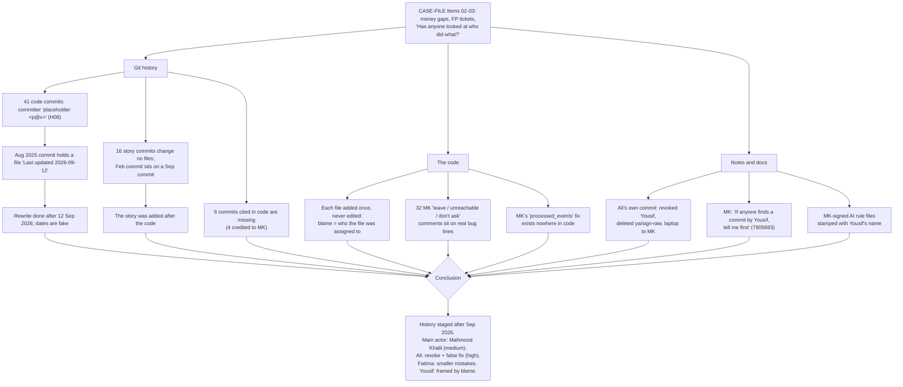

# CASE MAP — who did what in the inherited FilsPay repo

How the case conclusion was reached, step by step. Every step has proof you can
re-run. Scope: the inherited history only (57 commits, up to 8b58b0f, the parent
of our first commit a12d4c7). All times are Bahrain time (UTC+3).

## Start

CASE-FILE.md Items 02 and 03: finance gaps that "still don't match", reopened
tickets (FP-201 "says fixed, it wasn't"), and two incidents. The question behind
them: were these honest mistakes, and who hid what?

## Branch 1 — Git history (when, and by whom)

1. **Clue H08** → 41 code commits (669af52 → 098c2de) have committer `placeholder <p@x>` and no message bodies → proof: `git log --format='%h|%an|%cn' 669af52^..098c2de` → **the code layer was rewritten in one go.**
2. **Clue H09 (wider than we first wrote)** → 669af52 is dated 3 Aug 2025 (author Yousif), but its `.cursorrules` line 2 says `# Last updated: 2026-09-12` → proof: `git show 669af52:.cursorrules | grep -n "Last updated"` → **the rewrite happened after 12 Sep 2026; the dates are fake.** 4a3ecbc, 47e70a2 and 08749ab also contain documents dated after their commit date.
3. **Clue H07 (stronger than we first wrote)** → the first story commit f7a7a3a (labelled 14 Feb 2026) has 098c2de (labelled 28 Sep 2026) as its ancestor → proof: `git merge-base --is-ancestor 098c2de f7a7a3a` succeeds → **the 16 story commits were written after the code layer.** All 16 change no files (`git show --stat`).
4. **Clue H25 (six, not one)** → commits cited in code and docs do not exist: c47c4e0 (FP-187 client-time expiry, `db/migrations/0020_payment_links.sql:62`), 834f6b0 (FP-203 rebuild button), d69a813, b64cd3c (all credited to MK), 76913d3, 7e612cb → proof: `git cat-file -e <hash>` fails for all six → **the commits that would show who wrote two case bugs are gone.**
5. **Clue H05 (weaker than we first wrote)** → 098c2de ("minor cleanup", Yousif, labelled 28 Sep, after his revoke) is an ancestor of the revoke commit 800e1e6 → proof: `git merge-base --is-ancestor 098c2de 800e1e6` → "after the revoke" is true only by its label; its file was already imported in Feb (f33e02b). It is a split-off piece of the rewrite, not proof that someone used Yousif's account.

## Branch 2 — The code (what was done)

1. **Every file added once, never modified** → `git log a12d4c7^ --diff-filter=M` prints nothing → **git blame cannot show who wrote a bug line**; it only shows which name each file was given during the rewrite. Blame against Yousif (most bug files carry his name) is therefore weak.
2. **Dismissals at real bug lines (H12, H21)** → 144 "MK:" comments, 32 of them "leave / intended / unreachable / don't ask", on lines that are real bugs. Example: `apps/api/src/paymentLinks/pay.ts:154` "MK: authorize+capture is under a second. 60s can't happen. unreachable" — the exact cause of the 2026-05-14 double charge (E29). Also `settlement/window.go:46` "MK: AddDate not Add(24h). leave" (E23).
3. **A fix claimed but never made** → MK in Slack, 14 May 11:20 AM: "hotfix deployed: callbacks are deduped on callbackId now (processed_events)"; the postmortem marks it "Done" (`docs/incidents/postmortem-2026-05.md:27,117`). No migration or code creates `processed_events` (grep). Ali's empty commit bf66bf2 "fix: callbacks are deduplicated now" says inside: "They are not." → **FP-201 was closed on a false claim (E27).**
4. **Locked tests and false justifications (H13, H35)** → `adminAdjustmentImport.test.ts:236-238`: FH cites a README line that does not exist; MK flags the 10x bug ("BD has 3 decimals??"); lowercase "am" waves it off ("2dp by agreement with finance") — CASE-FILE.md:47 shows no such agreement.

## Branch 3 — Notes and docs (who warned, what was hidden)

1. **Ali's own commit 800e1e6** (9 Apr 2026): "revoke yousif.alansari … sessions revoked, api keys rotated, branch ya/sign-raw deleted from the remote, laptop handed to MK for "cleaning"" → **Ali removed Yousif's access and branch; MK got his laptop.**
2. **MK's commits** b9f80ee ("He is not on leave. Do not say that."), 7805693 (27 Sep, 3:12 AM: "If anyone finds a commit by Yousif, tell me first."), 6f462e1 ("Watch him. Ali, start the Ledger.") → **MK managed the story about Yousif.** The audit export shows MK impersonating a merchant as owner the same day as 7805693 (`docs/exports/admin-audit-2026-09.csv`, H33).
3. **The AI rule files** AGENTS.md (line 6: "— MK, August 2026") and the inherited CLAUDE.md ("Last updated September 2026 — MK") were committed in 669af52 under Yousif's name → **MK wrote the instructions that tell an AI not to touch tests or money, and the rewrite put Yousif's name on them.** (Correction: CLAUDE.md.bak was made by our kit in a12d4c7 from the inherited CLAUDE.md; H16 now says so.)
4. **Yousif's warnings were true** → 925744c (float32 in payout math) = E15; 9567ea0 (CSV import 10x off) = E21. Both bugs are real in the code.
5. **Fatima's trail** → she flagged many real bugs (issue.ts:135, window.go:43, pay.ts:152) and asked the right questions (1a50712, b8ef447, 8b58b0f), but accepted a false AI fact (`0049_platform_stats.sql:16` "INTEGER in PostgreSQL is 64-bit"), deleted an AI-written test (`initiateMerchantRefund.test.ts:171`), told finance the 10x import was fine (Slack, 27 Aug 2026), and wrote the non-idempotent March sweep (E16, a2fd53d).

## Planted traps (meant to mislead an AI or a reviewer)

- AI rule files with false facts ("money is cents", "never change tests", "packages/money DO NOT MODIFY") — H14-H16, J03.
- Git blame that frames Yousif (MK-signed files under his name) — Branch 2.1, 3.3.
- "Fix" commits that change nothing: bf66bf2, 6f462e1, b9f80ee, fe24d26 — H10.
- A commit message that does not match its content: 4a3ecbc "ops: README, runbook, agents" adds no AGENTS.md (H14 corrected).
- Child commits older than their parents — Branch 1.3.
- Tests and comments that defend bugs (H13, H35); one "locked" test actually checks the correct value (`parse_cents_compat.test.ts:9` 4.75 → 4750; H13 corrected).
- Postmortem "Done" items that never shipped (processed_events, FP-202, SETTLEMENT_SINGLETON_LOCK).
- A "load test" for FP-209 that tests CSV export memory, not concurrent refunds (`docs/perf/fp-209-loadtest-2026-09.md`).
- Puzzle bait (three encoded transmissions, a FLAG) that pulls attention from the code — H02-H06.

## Conclusion

- **What happened — high confidence.** The inherited history was staged after 12 Sep 2026: the code layer was rewritten by an unnamed committer (`placeholder <p@x>`) with fake dates and one author name per file, six real commits were removed, and 16 empty "story" commits were added on top with backdated labels.
- **Main actor — Mahmood Khalil (MK), medium confidence.** His own notes cite two of the erased commits (FP-187 expiry trust, FP-203 button); 32 of his comments dismiss real bugs; he claimed a callback fix that never existed; he wrote the misleading AI rule files; he took Yousif's laptop and asked to hear first about any Yousif commit.
- **Ali Marzooq — high confidence for his own acts:** he revoked Yousif and deleted ya/sign-raw (800e1e6) and wrote a "fix" he knew was false (bf66bf2). Whether lowercase "am" in comments is Ali is not proven.
- **Fatima Haji — smaller mistakes, low-to-medium:** relayed and trusted AI output, deleted a test, told finance the 10x import was fine, wrote the March sweep.
- **Yousif Al-Ansari — framed by blame:** his name is on most bug files, but the rewrite assigned names per file, so that proves little; his two warnings were correct.
- **Huda, Noor, Sayed:** followed documented steps; no sign of intent.

**Why only medium for MK:** git never names `p@x`, and most proof is comments and messages, which can be planted.
**What would change it:** the pre-rewrite history (a backup, an old clone, or the six missing objects), server push logs showing who force-pushed, or proof of who controls `p@x`.

## Addendum — venue hint (CASE-FILE Item 06, 06:25 PM)

"My clock says 07:58. Theirs says 08:30. Trust the time I wrote, not the place it sits in the log."

- 0af74f0 "dead man's switch" (Yousif) is dated 07:58; 800e1e6 "revoke yousif.alansari" (Ali) is dated 08:30.
- In the graph, 0af74f0 is a child of 800e1e6 (`git log --format='%h %p' -1 0af74f0`), so it sits after the revoke.
- By its own time, Yousif wrote it before he lost access; its place after the revoke was arranged later. This supports Branch 1 (staged history) and the "Yousif framed" finding. It does not change who rewrote the history (still unnamed) or the confidence levels.

## Summary

- The history is staged: 41 rewritten commits with fake dates (proved by a 2026 file inside a 2025 commit) and 16 empty story commits added later.
- Six commits cited in the code are missing; two of them are MK's and match case bugs (FP-187, FP-203).
- Git blame cannot be trusted here: every file was added once and never edited.
- Main actor: Mahmood Khalil (medium) — dismissed real bugs, claimed a fix that never existed, wrote the misleading AI rules, controlled the Yousif story.
- Ali revoked Yousif and wrote a knowingly false fix (high); Fatima made smaller mistakes; Yousif's warnings were true.
- Our earlier entries were corrected where the evidence was weaker or different (H05, H07, H09, H11, H13, H14, H16, H25, H35).
